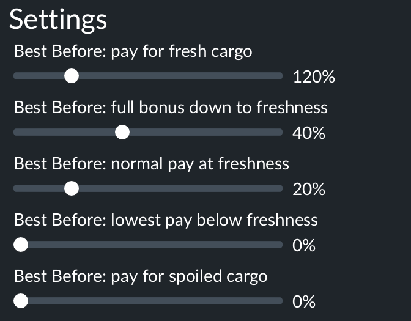

# Changing the mod's settings

## In short

- **Where.** The curve is set in game, in the mod's own settings dialog: the **Mods** tab, then the gear next to the mod. It is there in both **New Game** and **Load Game**. It is not under Gameplay Settings, which only holds the base game's settings.
- **How it works.** The game stores each setting in the save, shows the save's own values when you open the dialog, and hands the values to the mod when the save loads. Change a value before pressing **Load Game** and the mod uses it from that load on; the next save you make keeps it. A player can retune a save as often as they like.
- **How sure we are.** The route and the behaviour (the dialog shows the save's values, a change made before loading reaches the mod and is saved) were checked in the game on new games and on an old save. The five settings were run at the defaults and at three non-default sets, and for every setting that was not clamped the dialog, the saved header and the value the mod logged agreed. A long run on an old save with a changed curve (1,920 deliveries, with the bookings, before 1.2) passed `verify_run.py`, and replaying the arrivals with those numbers reproduced the logged deductions (-4,636,930 against -4,636,941) and bonuses (+10,889,581 against +10,889,569).
- **Old saves.** A save from before the settings existed shows the defaults in the dialog and loads on the default curve, whatever curve it used before; the next save you make stores them. Set the values you want before pressing Load Game.
- **A mod added to an old save.** Activating the mod on a save that never had it (Load Game, Mods tab) shows the defaults in the dialog; values set there before pressing Load Game reach the game: `preRunFn` logged them as `loadParams` (list positions 14/12/8/4/6), the probe's `curveSettings` agreed (165% / 55% / 35% / 15% / 25%), and both saves made afterwards hold them (checked once).
- **Saves with the old warehouse setting.** Saves made while the mod still had a setting for warehouse cargo load fine: the dialog shows the sliders at the values the save holds, the mod ignores the extra key, and the next save leaves it out (checked on two such saves). Warehouse cargo is always judged by its corrected age.
- **Stale threshold.** A sixth setting, "Warn on cargo below freshness percent" (0% to 25%, default 10%), sets only when a delivered unit counts as stale for the Stale Cargo warning ([stale-line-warnings.md](stale-line-warnings.md)); it does not change pay. It came with 1.2 and was checked in the game on one save: the dialog shows it, a change made before Load Game reaches the mod and is saved, and the logged value agrees (see the test at the end). A save from before it shows the default and stores it at the next save.
- **Warnings switch.** A seventh setting, the check box "Show Stale Cargo warnings" (on by default), turns the Stale Cargo warnings off: the warnings shown are taken down and each line's history is forgotten, so ticking it again starts the count fresh. It is the way to clear the warnings before removing the mod from a save ([removing-the-mod.md](removing-the-mod.md)). It came with 1.2 and was checked once in the game: a save from before it shows the box ticked, and unticked on Load Game it reached the mod and took the warning down.
- **Non-perishable cargo.** An eighth and ninth setting, "Non-perishable cargo" (a list: Full bonus, No bonus, No effect) and "Non-perishable delivery time" (15 to 75 min), choose how cargo with a long base delivery time is paid. They come with 1.3. Checked once in the game, with No bonus on an old save: the dialog showed the defaults, the game handed the list to the mod as its 1-based position like a slider, and every non-perishable unit was paid normal pay while the food kept its bonus (see the test at the end). Not yet checked: No effect, another cutoff, No bonus on late cargo, and the positions stored in the save header.
- **Unknown.** Whether backing out of the dialog without pressing Load Game leaves the save untouched (not tried).

## On a new game

1. On the New Game screen, open the **Mods** tab.

   

2. Find the mod's card. The mod has to be active (its button reads **Activated**; the other mods' buttons read **Activate**). Click the gear to its right.

   

3. The dialog lists the mod's settings under **Settings**. Set the sliders, then close the dialog with the X at its top right. The dialog opens with the values of the last new game you set up, not the defaults, because the game keeps the New Game screen's choices in its `settings.lua` in your user folder. Check them before you start.

   

4. Start the game as usual.

## On a saved game

1. Open **Load Game**, from the main menu or from the Esc menu inside a running game.
2. On the save's card, click the gear (it is the **Details** button, next to **Load Game**).

   

3. Open the **Mods** tab.

   

4. Click the gear on the mod's card, as in step 2 above. The settings show the values this save holds. Change what you want and close the dialog with the X.
5. Press **Load Game** at the bottom right of the details page. The mod uses the new values from this load, and the next save you make stores them.

## What the settings do

Pay is shown as a share of normal pay, so 100% is the pay the game gives and 150% is a 50% bonus. Freshness is 100% when cargo is picked up and falls to 0% at its delivery limit. Every percent slider moves in 5% steps. The curve is drawn out in [how-it-works.md](how-it-works.md).

| Setting | Range | Default | Meaning |
|---|---|---|---|
| Bonus pay multiplier for fresh cargo | 100% to 200% | 120% | Pay for cargo delivered at full freshness. 100% means no bonus. |
| Get full bonus down to freshness percent | 0% to 100% | 40% | The fresh-cargo pay holds while freshness is at or above this, then falls in a straight line. |
| Normal pay at freshness percent | 0% to 100% | 20% | Cargo delivered at exactly this freshness earns normal pay. |
| Lowest pay below freshness percent | 0% to 100% | 0% | At or below this freshness the spoiled pay applies. |
| Pay multiplier for spoiled cargo | 0% to 100% | 0% | The lowest pay: 0% takes the whole pay of a unit. Also used for cargo the game marks as spoiled. |
| Warn on cargo below freshness percent | 0% to 25% | 10% | Only the Stale Cargo warning ([stale-line-warnings.md](stale-line-warnings.md)): a delivered unit below this freshness, or spoiled, counts as stale. Does not change pay. 0% counts only spoiled cargo. A new threshold applies to deliveries from then on; months already measured keep the old one until they leave the 12-month window, so a warned line clears only gradually after a change. |
| Show Stale Cargo warnings | on or off | on | Only the Stale Cargo warning. Off takes down every warning shown and forgets the lines' history; on again starts it fresh. Untick it, load and save before removing the mod: a save that holds a warning does not load without it ([removing-the-mod.md](removing-the-mod.md)). Does not change pay. |
| Non-perishable cargo | Full bonus, No bonus, No effect | Full bonus | How cargo at or above the non-perishable delivery time is paid: the whole curve, the curve's penalties only (pay never above normal), or normal game pay. Stale Cargo warnings count it in every case. |
| Non-perishable delivery time | 15 to 75 min, 5 min steps | 25 min | The base delivery time (the cargo file's `timeToDeliverInSeconds`) from which a cargo is non-perishable. At 25 min only food is perishable (meat 15 min, fish, vegetables and beverages 18.75 min, grain 21.4 min); goods sit at 25 to 37.5 min, raw and bulk cargo at 50 and 75 min. The Delivery Time tab shows the base time x 1.5 in 1900, falling to x 0.75 from 2020. |

If the freshness points are not in order (full bonus >= normal pay >= lowest pay), the mod lowers the later point to the earlier one: with 35%, 45% and 70% it runs on 35%, 35% and 35%, while the dialog keeps showing what was set. The mod writes the values it used to the game log as `BEST_BEFORE curveSettings`, with the source (`params` for the in-game settings) and `adjusted=yes` when it had to lower points. That line comes only when the curve differs from the one stored in the save; the `BEST_BEFORE loadParams` line (the settings as list positions, one per load) is what the tools read to know the curve a run was played on.

Saves made before the settings existed have none, and the game fills in the defaults, so the mod plays them on the default curve (checked on one such save). The curve in [settings.tl](../best_before_1/content/settings.tl) is only a fallback for when the game hands over no settings.

## Test: the stale threshold slider (24 Oct 2026)

One old save with the mod already active (save series WR26A Giga-Tv3 1915, 1.2-dev from the staging folder), three saves in a row. The values are the stored list positions (1-based; 3 is 10%, 5 is 20%); the header was read with `save_header.py` of the [tf3-save-format](https://github.com/WuphonsReach/tf3-save-format) repo.

| Step | Save header (`best_before_1` params) | Game log |
|---|---|---|
| Save made before the slider existed (`1024-1545`) | five keys, no `bestBefore.staleBelow` | |
| Load Game, dialog showed 10%, saved as `1024-1606` | `bestBefore.staleBelow` = 3 | `loadParams ... staleBelow=3` |
| Load Game with the slider raised to 20%, saved as `1024-1620` | `bestBefore.staleBelow` = 5 | `loadParams ... staleBelow=5`, `staleRoll ... staleBelow=0.2` |

`verify_run.py` passed on the 20% run with 229 units checked against the threshold. Not tried: a 0% or 25% setting, and what the warning does on a line whose recent months were measured at the old threshold.

## Test: non-perishable cargo, No bonus (28 Oct 2026)

One old save made before the settings existed (WR26A Giga-Tv3 1900, Jan 1900, its own curve 150% / 50% / 15% / 0% / 0%), 1.3-dev from the staging folder. The dialog showed Full bonus and 25 min; No bonus was picked before Load Game. The log had `loadParams ... nonPerishable=2 nonPerishableTime=3` and `curveSettings ... nonPerishable=noBonus nonPerishableSeconds=1500`. About 11 minutes of play, 722 units, `verify_run.py` passed:

| Class | Cargo type | Base time | Units | Pay | Freshness (corrected) |
|---|---|---|---|---|---|
| Perishable | 6 | 1125 s | 148 | x1.50 | 0.79 to 0.83 |
| Perishable | 9 | 1125 s | 120 | x1.49 on average | 0.48 to 0.56 |
| Non-perishable | 18 | 3000 s | 251 | x1.00 | 0.83 to 0.85 |
| Non-perishable | 12, 13 | 3000 s | 120 | x1.00 | 0.77 to 0.93 |
| Non-perishable | 20 | 2250 s | 83 | x1.00 | 0.44 to 0.52 |

Every non-perishable unit was fresh enough for the full bonus and was paid normal pay. All 722 units were counted for the Stale Cargo warning; none was stale. No non-perishable unit fell below break-even, so the penalty side of No bonus was not exercised.
