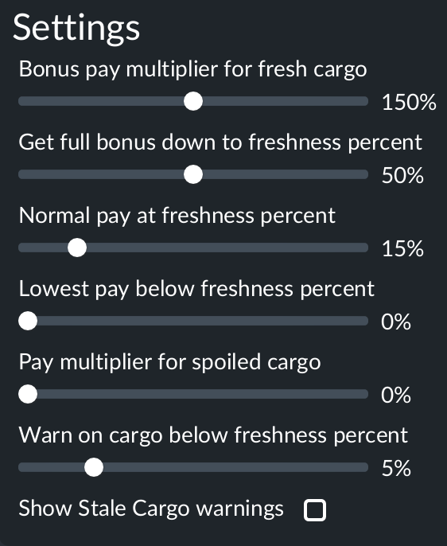

# Removing the mod from a save

## In short

- **Why there are steps.** The game keeps a shown Stale Cargo warning in the save, and only this mod can draw it. A save that holds one and is loaded without the mod stops with "Failed during startup" (a Lua error, `Resource not found`, naming `best_before_1::/stale_line_warning.script@useDataState`), with only Reload UI or Back to Main Menu offered. A save with no Stale Cargo warning shown loads without the mod like any other.
- **What to do.** Turn the warnings off in the mod's settings, load the save, save it, then load that save with the mod deactivated (steps below). Turning them off takes every Stale Cargo warning down.
- **What else is left behind.** Nothing that stops a load. The pay change exists only while the mod runs: deliveries already paid stay paid, and the game drops the mod's game script and its saved state when the mod is gone (the log says `Removing entity … for GameScript best_before_1::/probe.gs which is no longer available`).
- **Adding it back later.** A save made without the mod keeps none of its settings: the game drops the mod's entry, settings included, from the save. Activating the mod on such a save again starts from the defaults (warnings on, the default curve), not the values the save had before, so set them again on Load Game before loading. Checked on one save (`1024-2235`, saved without the mod: no `best_before_1` entry left in its header).
- **How sure we are.** The steps were followed once, on a save that held one Stale Cargo warning and had failed to load without the mod: after them it loaded and ran (test at the end). The off switch is new in 1.2. In 1.0.1 the same switch is `staleWarnings = false` in the mod's `settings.tl`, which means editing a file in the mod's folder.
- **Unknown.** The notification log's History tab still lists the old warning after it is taken down. The save loaded with that entry in it, but clicking the entry in a game without the mod was not tried.

## Steps

1. Open **Load Game** and click the gear on the save's card (the **Details** button, next to **Load Game**).

   

2. Open the **Mods** tab and click the gear on the Best Before card.

   

3. Untick **Show Stale Cargo warnings** and close the dialog with the X. The other settings do not matter here.

   

4. Press **Load Game**. Once the game is running, let it run for a few seconds: the warnings are taken down on the mod's first update after loading. The notification log's **Active** tab no longer lists a Stale Cargo warning.
5. Save the game (a new name keeps the old save as a backup).
6. Back in **Load Game**, open that save's **Mods** tab, deactivate Best Before, and load. The save now plays without the mod.

**If the mod is already gone** and a save fails to load: subscribe to the mod again (or put it back in the mods folder), activate it on that save's **Mods** tab, and follow the steps from step 3. This path follows from the same mechanism but has not been tried on its own.

## Test: one save, warning on, then off, then without the mod (24 Oct 2026)

Save WR26A `1024-2036` (Feb 1919, Hard), which held one Stale Cargo warning (line CRA-DER CXR West Grain). Loaded without the mod earlier the same day, it stopped with "Failed during startup" (log `local/logs/stdout-20261024-mod-removed.txt`). Log of this test: `local/logs/stdout-20261024-warnings-switch.txt`.

| Step (local time) | What the screen showed | What the log showed (UTC) |
|---|---|---|
| Mods tab, the mod's gear (22:02:28) | **Show Stale Cargo warnings** present and ticked (the save had no value for it, so the game gave the default) | |
| Box unticked, Load Game (22:02:32) | | `loadParams … staleWarnings=1` (02:02:38) |
| First update after loading | | `curveSettings source=params … staleWarnings=false`, then `staleWarnings … count=0 lines=none` (02:02:54) |
| Notification log (22:03:31, 22:03:35) | History tab still lists "Most cargo delivered by "CRA-DER CXR West Grain" has arrived stale…"; the Active tab does not | |
| Saved as `1024-2203` (22:03:52) | | `Saving game complete` |
| Load Game, `1024-2203`, Best Before deactivated (Mods (20)) (22:04:30) | | no `BEST_BEFORE` line; `Removing entity 184925 for GameScript best_before_1::/probe.gs which is no longer available` (02:04:41) |
| In the game (22:05:36) | running, Feb 16 1919, a vehicle window open | no "Failed during startup", no `Resource not found` |
| Played on without the mod, saved as `1024-2235` (Jul 6 1919) | | the save's header lists 20 mods and has no `best_before_1` entry; `1024-2203` still had it, with `bestBefore.staleWarnings` = 1 among the settings |
